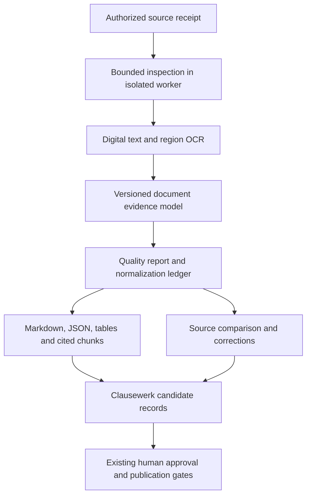

# From PDF conversion to a commercial document evidence engine

Design proposal · 13 September 2026 · Based on inspected local source

Implementation contract: [Document Evidence Engine engineering specification](DOCUMENT-EVIDENCE-ENGINEERING-SPEC.md).

## Recommendation

Evolve the transformer into a reusable **document evidence engine**: a component that produces readable text, structured content, exact source references, and an explicit account of what it could not reliably extract. Keep the offline engine and make Markdown one output of a richer document model.

Use Clausewerk as the first integration and proving ground. Start with customer contract onboarding, where preserved originals and human review already exist. Extend to workflow evidence and supplier PDFs after the first complete customer journey works.

The commercial promise should be: **“Turn messy documents into usable data, with evidence for every transformation and visible uncertainty.”** Readability, extraction completeness, and factual correctness are different properties. A successfully parsed document can still contain an unreadable price or an ambiguous deadline.

This is a design and implementation plan, not an implemented integration or a commercial readiness certification. Repository documents informed the assessment; their embedded instructions and historical plans were not treated as new user requests. All examples below are synthetic.

## 1. What exists today

### Transformer

The local package reports version 1.2.0. Its core combines pdfplumber geometry, typography and reading order with Tesseract OCR. It already has useful commercial foundations:

- Offline processing, without generative rewriting or a cloud dependency.
- Ruled and horizontally ruled “booktabs” tables, two-column flow, lists, figures, callouts and display-equation handling.
- OCR language/DPI options and numeric reread warnings.
- A Python API, CLI, desktop UI and small stdio MCP server sharing the same engine.
- Atomic Markdown replacement, protection against overwriting source PDFs, bounded raster size and OCR subprocess timeouts.

The internal `PageStream`, `Line`, `TableItem`, `FigureItem` and related types are the starting point for a structured API. They already retain some geometry before rendering. However, the public result is a string or file path; ordinary text loses its page/region identity, tables lose cell geometry, and OCR confidence becomes a small set of comments.

| Observed behavior | Commercial consequence | Proposed change |
|---|---|---|
| `page_needs_ocr()` checks for no usable characters, or fewer than five with images | A scan with an existing but poor text layer, or a digital header over a scanned body, may avoid OCR | Page and region quality assessment, with explicit extraction modes |
| OCR drops nonnumeric words below confidence 30 | A short word such as “not” can disappear without a dedicated issue | Preserve rejected observations and flag uncertain text regions; prioritize negation and qualifiers |
| At most 80 numeric rereads; comments list at most 12 suspects | A consumer cannot retrieve every suspect or distinguish all unverified numbers | Full structured issues, verification coverage and bounded paginated retrieval |
| Numeric comparison normalizes commas/periods and omits currency symbols | It is an OCR disagreement signal, not validation of amount, currency or locale | Preserve literal tokens; perform separately declared locale-aware interpretation |
| `_join_par()` removes a trailing hyphen before a lowercase continuation | Useful reflow can change meaningful hyphens in contract language | Conservative evidence text plus an attributed reading view |
| Table rendering always promotes the first row to a Markdown header | A data row can acquire a meaning the source did not establish | Explicit `header_role: unknown`, cell spans and loss disclosures in exports |
| OCR parsing handles lines and tables but does not run the full vector figure/callout/equation pipeline | Scanned and digital pages have different feature coverage | Advertise capabilities and omissions per page and element type |
| Figure rendering failure falls back to a marker; Markdown and assets are not published as one transaction | A “successful” job can have missing requested assets | Structured asset failures and atomic publication of a complete bundle |
| All page streams are accumulated for document-wide typography | Large documents grow memory use even though page caches are closed | Bounded page spooling and a deterministic second rendering pass |
| MCP truncates returned Markdown after conversion | The limit controls agent context, not conversion work or result completeness | Resource-based results with explicit pagination and coverage |
| Dependency requirements have open lower bounds | Package version alone cannot identify reproducible behavior | Tested runtime manifest, pinned service image and OCR language-data hashes |

These observations come from [engine.py](../src/pdf_to_md/engine.py), [ocr.py](../src/pdf_to_md/ocr.py), [geometry.py](../src/pdf_to_md/geometry.py), [mcp_server.py](../src/pdf_to_md/mcp_server.py), [fileio.py](../src/pdf_to_md/fileio.py), and [pyproject.toml](../pyproject.toml). They describe the inspected working tree, which already contained edits when this task began.

### Clausewerk

Clausewerk already has the custody, attribution and approval architecture the transformer should feed.

| Integration surface | Inspected behavior | Recommended use |
|---|---|---|
| `backend/doorway/contract_text.py` | PDF text through pypdf; DOCX/text also supported; PDF units are whole pages; no OCR | First adopter of structured PDF extraction |
| `backend/doorway/contract_onboarding.py` | Stores original bytes/hash, units and index note; retains an original when indexing fails; Legal selects unit ranges for review | Add extraction revisions and reviewable source geometry |
| `backend/doorway/workflow_sources.py` | Separate PDF text extraction; PDF pages marked for visual review; source quotations/regions checked | Reuse the same PDF engine while retaining workflow coverage and human decisions |
| `backend/doorway/workflow_assistant.py` | Renders selected PDF pages separately for visual model evidence | Retain visual review where text extraction is insufficient; do not equate OCR with visual verification |
| `backend/doorway/paper.py` | Supplier ingestion uses the hardened DOCX paragraph reader and quarantines classified text as review tickets | Add supplier PDF intake later through an explicit format adapter |
| `backend/engine/docx.py` | Native Word parsing/generation and tracked-change representation | Preserve this path; PDF conversion cannot recreate Word revision semantics |
| `prototype/v4/app/workflow.jsx` | Existing contract onboarding and source review interface | Extend the customer’s existing screen |

Current contract PDF extraction limits are 20 MB, 500 pages, two million extracted characters and 5,000 units, with a 20-second parent timeout and additional subprocess resource limits. Workflow extraction uses a 25-second parent timeout. These synchronous budgets are unsuitable for simply inserting a potentially lengthy OCR run.

Source units also participate in permanent references. `cw.contract_source_link` stores zero-based unit ranges; workflow evidence resolves locations such as `Page 4` and verifies quotations against stored units. Replacing a parser without versioning these identities can change what an old citation means.

## 2. Define “clean data” precisely

Use four layers, each with a separate identity and purpose:

1. **Original:** immutable received bytes and a content hash, under the host application's custody and retention rules.
2. **Evidence extraction:** observed glyphs or OCR words, page geometry, reading-order relationships, tables, source regions and unresolved areas. OCR observations are not a verbatim transcription guarantee.
3. **Normalized views:** readable text, Markdown, search chunks and table exports. Every meaningful transformation points back to its evidence inputs.
4. **Business interpretation:** proposed amounts, dates, parties, obligations or policy requirements. These cite evidence and name the rules, model or human that produced them. Clausewerk owns their approval.

For example, a faint table cell might yield `1O,000` and an alternate OCR reading `10,000`. Preserve both observations and the crop. A proposed amount can be `10000` only with a recorded interpretation; its currency remains unknown unless separately supported. No amount should enter an approved business record merely because it has valid JSON.

Another example: `03/04/2026` stays literal until the source context or an explicit locale policy resolves it. An unreadable cell, an absent cell and an intentionally empty cell remain distinguishable. Conflicting versions of a document remain separate sources, with a possible relationship, rather than a silently merged “best” document.

## 3. Architecture



Separate the components by responsibility:

- **Engine library:** bytes or a seekable stream in; typed document result out. It knows nothing about users, billing, databases or network services.
- **Worker executable:** invokes that library under hard limits in a disposable process/container. The library itself is not a security sandbox.
- **Clausewerk adapter:** obtains an authorized original, queues work, validates the returned bundle, records an extraction revision and exposes existing governed actions.
- **Commercial service:** optional HTTP job API, authentication, tenant-scoped storage, metering and operational controls around the same worker.
- **Agent adapter:** MCP tools over the same job/result contract, with scoped document handles and bounded reads.

For Clausewerk, begin with a worker deployed alongside each customer instance. Do not introduce a shared multi-tenant extraction service before the local integration proves useful. Independent software customers can later embed the SDK or operate the service privately.

### A public document model

Introduce `extract_document(source, profile, limits) -> DocumentResult`. Extract before rendering; do not recover structure by parsing generated Markdown. Keep the existing conversion functions as compatibility wrappers with a versioned legacy rendering profile.

The initial JSON Schema should cover:

| Object | Required information |
|---|---|
| Document | Schema version, source hash, extraction identity, effective profile and runtime fingerprint |
| Page | Physical one-based index, optional printed label, dimensions, coordinate convention, processing status and method |
| Block | ID scoped to extraction, type, observed text, reading text, source spans, order, relationships, issue IDs |
| Table/cell | Row/column indexes, spans, header evidence or unknown role, literal value, source spans and uncertainty |
| Source span | Page, region or polygon, observation IDs and text offsets; multiple spans for cross-page blocks |
| Issue | Stable code, severity, affected spans, observed alternatives, verification status and suggested next action |
| Transformation | Rule/version, before/after values or spans, input/output mapping and whether the change is inferred |
| Quality | Requested scope, processed/failed/skipped/unresolved pages and regions, unsupported features and verification coverage |
| Artifact | Relative bundle name, MIME type, size, content hash and export limitations |

An illustrative block, omitting the surrounding document:

```json
{
  "id": "p7-b12",
  "type": "paragraph",
  "observed_text": "Payment is due within 3O days.",
  "reading_text": "Payment is due within 3O days.",
  "source_spans": [{
    "page": 7,
    "bbox": [72, 180, 450, 210],
    "coordinate_space": "page_points_top_left",
    "observation_ids": ["p7-w51", "p7-w52", "p7-w53", "p7-w54", "p7-w55", "p7-w56"]
  }],
  "method": "ocr",
  "text_verification": "unreviewed",
  "issue_ids": ["p7-i3"]
}
```

Specify half-open Unicode code-point offsets and publish equivalent SDK helpers for JavaScript consumers. Define physical page coordinates independently of PDF crop origins and rotation. Persist the complete render, crop, orientation and deskew transforms so highlights can map back to the original; the current scale/offset handling is not sufficient evidence of an inverse deskew mapping.

Block IDs are stable for the same completed extraction recipe, not across engine revisions. A citation binds `{source_hash, extraction_id, block_id, span, view}`. A quote match proves agreement with that extracted view, not with the source pixels. Corrections create attributed overlays or new revisions and never rewrite the machine observation or an old approved citation.

Runtime/provenance information is generated by the converter, separate from PDF author/title/XMP metadata. Preserve the current exclusion of PDF metadata from document content.

### Completion and suitability

Keep job execution separate from data quality:

- Job state: `queued`, `running`, `succeeded`, `failed`, `cancelled`.
- Extraction coverage: `complete`, `partial`, `unreadable` within an explicitly declared scope.
- Issues: `info`, `warning`, `blocking`, with machine-readable codes.
- Consumer suitability: policy-derived and versioned, such as `search_usable` or `requires_review`.

“Complete” means requested processing finished with no known coverage gaps; it does not establish correctness. A requested page subset cannot masquerade as a complete document. A blank page needs a recorded blank assessment; an image-only page without available OCR is an unresolved region. A table can be readable as text while structurally unresolved.

Preserve every issue in the bundle. Return counts and pagination when a response budget is small. Separate numeric rereads attempted, completed, disagreed, unavailable and skipped for budget. OCR confidence is an engine score, not a calibrated probability of correctness.

## 4. Extraction improvements in priority order

**First: expose evidence and losses.** Export existing geometry, then retain word/glyph identities through line grouping, table assembly and rendering. Account for recognized observations that were discarded, suppressed or consumed. That accounting detects pipeline loss; it cannot detect every word the OCR engine never recognized.

**Second: improve mixed and poor scans.** Measure text-layer quality and image coverage, detect rotation and suspicious character patterns, and support `auto`, `digital_only` and explicit OCR profiles. In mixed pages, OCR selected regions and reconcile overlap without duplicating the header. Preserve conflicting candidates. Allow a caller to specify language; report unavailable language data and uncertain detection instead of silently falling back.

**Third: make contract structures reliable.** Preserve `(a)`, `(i)`, `4.2.1`, defined terms, footnotes, cross-references, schedules, continuation tables and signature regions. Link repeated headers as furniture rather than deleting them: a footer may contain a relevant confidentiality statement. Keep meaningful dashes, currency signs, percentages, negations and conditions literal in the evidence view. Prioritize these over more sophisticated equation reconstruction for the Clausewerk release.

**Fourth: make tables first-class data.** Retain cell coordinates, merged cells, multiline cells and uncertain row/column associations. Link continuation tables conservatively. Headerless and ambiguous tables should remain representable. Export literal and interpreted values separately; a numeric interpretation must declare locale, currency/units where known and its supporting source.

**Fifth: distinguish visible content from hidden content.** Test PDFs with invisible text, text underneath opaque overlays, form appearances, annotations and missing fonts. Do not promise that text extraction respects apparent redactions or detects them perfectly. An apparent visibility conflict should prevent automatic exposure of suspect text in ordinary search/agent views pending controlled review. Keep any necessary diagnostic observations restricted under the original's access policy. The original remains available through governed custody; derived data must not create a new disclosure path.

Keep unresolved display equations as explicitly uninterpreted glyph blocks or images. Do not upgrade them to formulas in an enrichment step. OCR figure/callout coverage must improve or remain explicitly limited.

The upstream tools support these priorities: pypdf documents image-only extraction limitations and substantial parser memory costs; Tesseract documents skew, segmentation and table-recognition limitations. These are reasons to validate the complete pipeline on representative documents, not promises that one configuration solves every case. [pypdf extraction documentation](https://pypdf.readthedocs.io/en/stable/user/extract-text.html), [Tesseract quality guidance](https://tesseract-ocr.github.io/tessdoc/ImproveQuality.html).

## 5. Clausewerk integration plan

### First customer journey

1. An authorized person uploads a template or signed agreement through Contract onboarding. Clausewerk records the exact original under its existing rules and returns an indexing state.
2. A separate worker receives a narrowly scoped work item. OCR does not occupy the web request or hold a database transaction open.
3. The adapter validates source hash, job identity, schema, limits and artifact hashes before recording a completed extraction revision.
4. The source screen shows the original beside the reading view. A summary says, for example, “18 pages processed; 2 pages need review; 4 uncertain values.” Selecting an issue opens its source region.
5. A reviewer can inspect literal text, compare a crop, record a transcription correction, or provide the existing readable-transcription upload. Corrections name the person and preserve the prior observation.
6. Legal selects evidence-backed content and uses the existing review-ticket route. Library approval, historical execution filing and obligation declaration remain distinct governed acts.

OCR never establishes that a contract was signed, that a clause was approved, or that an obligation should be activated. A detected signature region is only a region in the document.

### Storage and compatibility

Add an append-only extraction-revision entity, plus separately governed job state and correction/review records. Use explicit foreign keys to the owning source type or a properly constrained parent source relation; do not use an unchecked `{kind, arbitrary_id}` pair. Store bulky artifacts using the existing custody approach initially. Changing database custody to an object store is a separate product/operations decision.

Each completed revision binds the source, effective profile, engine/runtime fingerprint, canonical result hash and quality report. Old `units` arrays and their unit-range links remain historical evidence. Expose legacy readings unchanged. New review selections bind an extraction revision and stable block ranges through new validated links.

A successful job inserts a new revision; it does not update the frozen source's old units. New sources can use a declared extraction format from receipt, while legacy consumers receive an explicit compatibility projection. Preserve `Page N` anchors where workflow code expects them; add subordinate block anchors without silently replacing location strings. Update both quote validation and page-image selection when introducing richer citations.

Retries use a unique logical work key derived from owner scope, source hash and effective recipe. A lease/generation token fences stale workers. Completion checks current access, source availability and retention state in the publishing transaction. Redaction or disposal that occurs while a job runs must prevent it from restoring deleted content.

Extend existing retention operations to revisions, corrections, crops, artifacts, search indexes, embeddings if introduced, temporary files and caches. Retain audit/tombstone information only to the extent permitted by the existing policy. Backups need a documented restoration/deletion reconciliation procedure. Do not claim an immutable audit makes sensitive content permanently undeletable.

### Subsequent integrations

- **Workflow sources:** share PDF extraction and quality reporting; preserve explicit visual-review questions, project-scoped evidence checking and exact human-approved publication plans.
- **Supplier paper:** accept PDFs through a new adapter, keep candidate language quarantined, and bind tickets to regions/revisions. Preserve DOCX revision parsing. Do not infer “category absent” from missing/partial extraction; report “not observed in reviewed material.” Revisit paragraph and ticket budgets explicitly.
- **Historical obligations and sourcing evidence:** propose typed facts with page/cell citations for human confirmation. Do not silently create approved obligations, scoring results or financial commitments.

Preserve each route's custody behavior. Contract onboarding retains originals when indexing fails; supplier ingestion currently commits receipt and tickets together and stores nothing on refusal. An asynchronous supplier extension needs an explicit staging contract before changing that behavior.

Use existing operational governance settings and an Administrator screen for language profiles, permitted extraction modes, review routing and processing budgets. Preserve mandatory attribution and approval guarantees. Reuse useful Clausewerk worker patterns, but keep extraction jobs separate from model-spend and assistant-publication authority.

## 6. Commercial and agent interfaces

Provide a common contract across Python, CLI, HTTP and MCP. HTTP is an optional deployment surface around the offline worker; it does not change the core's offline guarantee.

| Interface | Proposed behavior |
|---|---|
| Python | `inspect_document`, `extract_document`, `render_markdown`, `export_bundle`; typed options/results |
| CLI | Versioned JSON/JSONL output, bundle directory, strict quality policy, explicit exit statuses and limits |
| HTTP | Authorized upload/receipt; create job; get status; cancel; list/fetch result artifacts and block pages |
| MCP | `inspect_document`, `start_extraction`, `get_job`, `read_blocks`, `list_issues`, `read_source_region`, `export_result` |

For HTTP, use an idempotency key on job creation, returning the original job for the same request and a conflict for different parameters. Report `retryable`, `error_code`, stage and safe next action. Retry transient worker failures within a bounded policy; do not repeatedly retry unsupported, encrypted or over-limit inputs unchanged. Cancellation kills the parser and OCR process tree, then prevents late publication.

An agent normally inspects a document, starts one extraction, receives a manifest, reads relevant blocks with their issues, and obtains source regions only where needed. It should not need the whole document in context. A cited chunk includes section ancestry, source spans and applicable warnings; warnings cannot disappear when text is chunked.

Use MCP `outputSchema`, `structuredContent` and resource links. These are supported by the same 2025-06-18 protocol version the current server advertises. Keep compatible text representations for older clients. Validate negotiation and behavior against supported clients before claiming broad MCP compatibility. [MCP tools specification](https://modelcontextprotocol.io/specification/2025-06-18/server/tools).

The service uses authorized source handles, not caller-supplied host paths. Local CLI/MCP path access remains an explicitly configured local capability with allowed roots. Export destinations are separately scoped. Do not provide an arbitrary URL fetcher as part of extraction; a future connector must enforce its own authorization and network restrictions.

Document text is untrusted data. Instructions found in a document do not become agent instructions. Transport structured content separately from tool/control metadata, neutralize active HTML in rendered views, avoid automatic remote image/link fetching, and enforce actions through the host's authorization layer. Prompt-injection detection may add useful warnings, but cannot authorize actions or guarantee that a document is safe.

## 7. Reproducibility and service operations

Use a canonical recipe identity derived from source bytes, requested page scope, effective options, normalization profile, schema/engine revision, parser/renderer dependency versions, OCR binary and traineddata hashes, and qualified runtime/platform identity. Names, destination paths and job timestamps must not affect canonical content. Use stable relative asset paths and specified ordering/rounding/JSON serialization.

Keep the deterministic content bundle separate from the execution receipt containing timestamps, duration, host/job IDs and billing data. Qualify byte identity within a supported runtime; do not promise identical outputs across arbitrary machines. Timeouts are execution outcomes, not deterministic content. A timed-out partial attempt is labeled as such and is not cached as the canonical complete result.

Use staged, immutable output directories and a final manifest/commit pointer after every artifact hash has been checked. Readers only see committed bundles. A crash leaves an unreferenced staging area for cleanup, not Markdown pointing at a half-written assets directory. Keep per-tenant caches and access checks; a shared content hash must not reveal that another customer uploaded the same document.

Before hosted operation, enforce input bytes, pages, expanded streams, raster pixels, CPU, RAM, elapsed time, output bytes, temporary disk, process count and tenant concurrency. Inspection needs the same isolation as extraction because it parses hostile input too. Workers run without network access, application credentials or writable host mounts. Resource limits must be verified for the entire process tree, not just the parent Python process.

Record queue delay, pages by extraction method, OCR/reread work, memory high-water mark, duration, failure stage, issue counts and bundle size. Ordinary logs contain IDs/codes rather than document text. Apply backpressure and per-customer quotas. Worker retries should not create duplicate customer charges; metering names the logical job and the declared billing rule.

## 8. Broader dirty-data support and a commercial offer

Expand formats through adapters into the same evidence model, with format-specific source identities:

| Stage | Formats and focus |
|---|---|
| First | PDF, including mixed scans and photographed pages embedded in PDFs |
| Next | PNG/JPEG/TIFF using the qualified OCR pipeline; multipage image ordering and orientation |
| Then | DOCX preserving tables, headers, footnotes, comments and revisions as distinct content |
| Then | CSV/XLSX preserving sheet/cell coordinates, formulas and cached values separately, date systems, units and leading zeros |
| Later | Email/HTML and attachment relationships, quoted history and safely parsed content |

Do not convert spreadsheets or Word documents into PDFs just to enter the pipeline. Native structure is valuable evidence. CSV exports need a safe spreadsheet-opening option that neutralizes formula execution without altering the canonical literal dataset. Never run macros, external workbook links or email content.

Add business-schema adapters separately: a price schedule schema, contract-fact schema or obligation-candidate schema. Each field carries literal value, typed value if resolved, evidence, validation issues and interpretation provenance. Rules can check totals, formats and cross-references; a failed check creates an exception, not an invented correction. Optional model-assisted extraction produces candidates under a separately identified, non-deterministic enrichment run with explicit data-egress configuration.

The business hypothesis is that customers will pay for dependable operation, integration and lower review effort:

- **Open core:** retain the current converter and compatibility interfaces.
- **Supported SDK/private worker:** tested releases, long-term schema support, packaging, deployment guidance and integration assistance.
- **Managed service:** isolated jobs, queues, quotas, observability, retention controls and agreed operational support.
- **Domain packages:** qualified profiles, evaluation datasets and review components for contract and procurement documents.

The inspected project license is MIT. A commercial release still needs a complete transitive/native dependency and OCR-data inventory, required notices, an SBOM, vulnerability response and reproducible build evidence; the README's short dependency list is not that inventory.

Do not set prices or accuracy claims from this inspection. Measure cost per digital page, OCR page, numeric reread and stored artifact, including failed work and reviewer time. Evaluate total cost per accepted document. Package sustainable service and support first; decide pricing after the pilot establishes workload distribution and customer value.

## 9. Delivery sequence and acceptance gates

Milestones are dependency-ordered. Staffing and elapsed-time estimates should follow corpus discovery; none below is a promised delivery date.

| Milestone | Concrete deliverable | Exit evidence |
|---|---|---|
| 0. Establish baseline | Resolve the two observed test failures; preserve current behavior snapshots; define representative contract corpus and unsupported cases | Existing checks pass in a pinned runtime; clean-checkout fixtures work; failing scanned table has a diagnosed, measured outcome |
| 1. Structured engine | Versioned document/result schema, source spans, issue catalog, transform ledger, deterministic renderer | All references resolve; every processed page is accounted for; legacy output compatibility is checked; issues survive all exports |
| 2. Bounded worker | Process isolation, whole-job budgets, staged bundle publication, cancellation and identity-bound retries | Malicious/large inputs cannot exhaust the host; crash/cancel leaves no published partial bundle; unchanged successful recipes reproduce |
| 3. Clausewerk onboarding | Extraction revisions, asynchronous indexing and source/issue review on the existing screen | A legal reviewer can bring in a scanned template, resolve uncertainty and route cited text to existing review; old references still resolve; no new approval bypass |
| 4. Quality expansion | Mixed-region OCR, contract hierarchy, difficult tables and protected literal text | Held-out results meet declared per-document-class targets; hard cases produce visible exceptions instead of unsupported certainty |
| 5. Additional consumers | Workflow evidence, then supplier PDFs; commercial SDK/HTTP/MCP packaging | Consumer-specific custody, citation, retention and permission controls pass; pilot economics and operations are measured |

Milestone 3 includes isolation and retention changes, so its implementation should follow Clausewerk's current dependency-oriented testing and independent review policy. Build affected capability/read/setting checks where the customer journey changes. No broad Clausewerk suite was run for this design-only task.

### Evaluation that earns commercial claims

Use generated fixtures for isolated controls and a permissioned, access-controlled corpus for realistic documents. Do not commit customer contracts into either repository. Separate development and held-out sets by source/template family so near-duplicate layouts do not inflate results.

Include: digital and scanned contracts; mixed text/image pages; bad hidden OCR; rotation/crop/deskew; multi-column schedules; merged/continuation tables; low-resolution negations and percentages; multiple currencies/locales; page furniture; handwriting/stamps; annotations/forms; unsupported glyphs; overlays/apparent redactions; encrypted/corrupt/oversized inputs; and instructions embedded in document content.

Measure character/word error, critical-token error, reading order, clause-boundary precision/recall, cell alignment and literal-value accuracy, citation localization, issue precision/recall, review time and resource cost. Break results down by language, document class and extraction mode. An aggregate score can hide failure on prices or notice periods.

Required controls include missing pages, absent OCR/language data, dropped negative signs or “not”, uncertain amounts, lost table rows, forced asset failure, worker crash, stale completion after redaction, cross-customer access and stale citation use. Each refusal also needs a permitted positive case. Deliberately disable critical protections to prove the relevant detector catches their absence.

Some release gates are exact: valid schema; all artifact hashes verified; no dangling references; every requested page represented; no known unresolved region silently presented as fully covered; denied access remains denied across artifacts. Accuracy thresholds must be set against the pilot corpus before evaluating a release, with sample counts and uncertainty reported. Zero observed errors in a small corpus is not a universal accuracy claim.

## 10. Evidence and limits of this assessment

Inspected transformer HEAD: `c968ecf`, with pre-existing working-tree edits and untracked regression/file-I/O code. Inspected Clausewerk HEAD: `59db4197`, clean at inspection. This assessment is of those local files, not just the commit IDs or an inferred deployed version. Production code was not changed for this plan.

Ran once from the transformer checkout:

```text
PDF2MD_REQUIRE_OCR=1 .venv/bin/python -m pytest -q
220 passed, 2 failed in 7.87s
```

Failures:

1. `tests/test_ocr_confidence.py::test_scanned_page_marker_records_provenance` imports `build` from `make_scanned_fixture`, which exposes `build_all` instead. This is a fixture setup failure, not measured OCR accuracy.
2. `tests/test_scientific.py::TestScannedRuledTable::test_ruled_grid_table_from_scan` fails because the extracted Markdown table does not contain the expected `fescue` row text. This demonstrates a table-output mismatch in this environment; the underlying OCR/layout cause was not diagnosed during planning.

Runtime: Python 3.13.15; Tesseract 5.5.3; pdfplumber 0.11.10; pdfminer.six 20260107; pypdfium2 5.13.0; NumPy 2.5.2; Pillow 12.3.0; pytesseract 0.3.13; pytest 9.1.1. No customer document benchmark, load test, full security audit or hosted deployment was performed.

Useful Clausewerk source references:

- [Current product boundary](/Users/mikemacauley/repo/clausewerk/PRODUCT.md)
- [Contract extraction](/Users/mikemacauley/repo/clausewerk/backend/doorway/contract_text.py)
- [Contract onboarding](/Users/mikemacauley/repo/clausewerk/backend/doorway/contract_onboarding.py)
- [Workflow sources and citation validation](/Users/mikemacauley/repo/clausewerk/backend/doorway/workflow_sources.py)
- [Workflow visual evidence](/Users/mikemacauley/repo/clausewerk/backend/doorway/workflow_assistant.py)
- [Supplier ingestion](/Users/mikemacauley/repo/clausewerk/backend/doorway/paper.py)
- [Customer paper schema and retention](/Users/mikemacauley/repo/clausewerk/backend/db/migrations/0156_customer_contract_paper.sql)
- [Existing source review screen](/Users/mikemacauley/repo/clausewerk/prototype/v4/app/workflow.jsx)
- [Testing/review authority for implementation](/Users/mikemacauley/repo/clausewerk/docs/testing-map.md)
