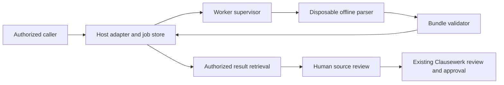
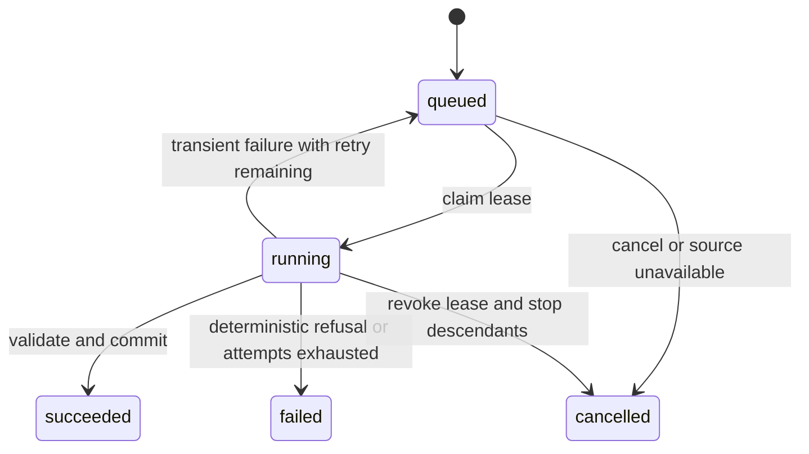

# Document Evidence Engine: engineering specification

**Specification:** DEE-1, revision 1.0 · **Date:** 2026-09-13  
**Status:** Proposed implementation contract; no production implementation implied  
**Parent:** [Commercial data engine and Clausewerk plan](COMMERCIAL-DATA-ENGINE-AND-CLAUSEWERK-PLAN.md)

## 1. Objective and release boundary

Build an offline document extraction engine that emits structured evidence, readable derivatives, source citations and explicit quality issues. Integrate it into Clausewerk contract onboarding without changing the meaning of existing source references or allowing extracted content to bypass named human approval.

The first deployable release, **R1**, includes PDF extraction, OCR, the evidence schema, a bounded worker, immutable extraction revisions, source comparison and governed review in Clausewerk. **R2** adds the standalone commercial HTTP service and the new MCP interface. **R3** extends workflow evidence and supplier PDF intake. Other formats and business interpretation are extension contracts, not prerequisites for R1.

R1 supports born-digital, image-only and mixed PDF pages using the routing policy in §7. It preserves uncertain structures and exposes known omissions. It does not promise universal OCR accuracy, legal correctness, signature verification, perfect hidden-content detection, handwriting recognition or recovery of Word tracked changes from a PDF.

**MUST**, **MUST NOT**, **SHOULD** and **MAY** express requirements for the proposed implementation. Values labeled defaults are concrete initial engineering choices, subject to qualification before release; they are not measured production capacity. Open commercial choices in §19 do not block building the specified private R1 integration.

## 2. Invariants

| ID | Requirement |
|---|---|
| INV-01 | An original remains byte-identical until an existing authorized retention action removes it. Hashes are computed from received bytes, never filenames. |
| INV-02 | Every rendered text span is mapped to observations or a declared structural insertion. Every retained observation has a disposition. |
| INV-03 | Every requested page has a result, including blank, partial and unreadable pages. Known gaps and uncertainty survive retrieval and export. |
| INV-04 | A citation binds a source hash, extraction identity, content hash, text view and span. Reprocessing cannot change its meaning. |
| INV-05 | Normalization and human corrections preserve the machine observation and their own provenance. |
| INV-06 | Only completed deterministic processing produces a canonical bundle. Process timing and service identity never enter its canonical content. |
| INV-07 | Every artifact access rechecks source authority and retention. Hash equality confers no access. |
| INV-08 | Extraction, OCR, quality acknowledgments and correction records confer no contract approval, execution status or publication authority. |
| INV-09 | Retry, cancellation, lease expiry and deletion cannot publish duplicate, stale or resurrected results. |
| INV-10 | PDF inspection and processing execute under enforced limits outside the serving process. |
| INV-11 | Document instructions remain document data. They cannot select tools, recipients, credentials, destinations or approval actions. |
| INV-12 | Existing CLI/Python behavior and Clausewerk legacy citations remain available under explicit compatibility paths. |

## 3. Components and trust boundaries



| Component | Responsibilities | Authority |
|---|---|---|
| `pdf_to_md.evidence` | Typed document records, extraction, quality evaluation and pure renderers | No network, database, users or business actions |
| Worker child | Parse one staged input; write bounded staging outputs | Read one input, write one staging directory; no network or credentials |
| Supervisor | Enforce limits, monitor process tree, collect artifacts, validate outputs | Scoped local staging; no discretionary customer business writes |
| Host adapter | Authenticate receipts, queue/claim work, store revisions, govern retention and reads | Existing application identity and database authority |
| Clausewerk review adapter | Validate exact selected text and create quarantined review tickets | Existing named Legal caller; never worker identity |
| HTTP/MCP adapters | Translate requests/results to shared service contracts | Scope derived from trusted authentication, not caller JSON |

Hash verification establishes artifact integrity, not trust in a parser's assertions. The host MUST validate record relationships, counts, limits and publication preconditions independently of child output. It MUST NOT deserialize executable objects or accept filesystem paths supplied inside an untrusted bundle.

R1 deployment is one worker supervisor alongside each Clausewerk customer instance. There is no shared tenant database or cross-customer cache. Standalone service tenancy is addressed in §12.

## 4. Identity, canonicalization and versioning

### 4.1 Identities

Use SHA-256 digests as 64 lowercase hexadecimal characters. Concatenated hash inputs use the canonical JSON encoding below; do not concatenate ambiguous strings.

```text
source_hash     = SHA256(original_bytes)
recipe_hash     = SHA256(canonical(effective_recipe))
extraction_id   = SHA256(canonical(["dee-extraction-1", source_hash, recipe_hash]))
document_hash   = SHA256(exact_document_json_bytes)
manifest_hash   = SHA256(exact_manifest_json_bytes)
```

An `extraction_id` identifies deterministic work. `job_id`, `attempt_id` and database revision IDs identify operational records and MUST NOT appear in `document.json`. Hashes MUST NOT be exposed across unauthorized scopes. A second successful execution of one extraction ID producing a different manifest hash is `NONDETERMINISTIC_RESULT`: quarantine it and stop cache reuse for that recipe/runtime; never overwrite the first result.

### 4.2 Effective recipe

The recipe MUST contain all resolved values, including defaults: schema version, engine source/build digest, renderer/rule versions, requested physical pages, required feature set, routing profile, OCR language order, DPI/PSM, verification limits, normalization profile, parser/renderer versions, Python version, OS/architecture qualification ID, OCR binary digest, traineddata digests, deterministic count limits, raster settings and required export set. The runtime inventory is produced by the supervisor and checked against the qualified image, not accepted from the PDF or a caller.

R1 recipe profiles are `evidence-conservative-1` and the separate existing `legacy-markdown-1`. Runtime limits based on elapsed time, RAM and CPU are recorded in the execution receipt. Crossing one terminates the attempt without a canonical result. Count limits that change which deterministic verification steps run belong in the recipe.

The normative recipe field names are `schema_version`, `engine_build_sha256`, `profile_id`, `routing_policy_id`, `normalization_policy_id`, `requested_pages`, `required_features`, `ocr`, `rules`, `runtime`, `count_limits` and `exports`. `ocr` contains `mode`, ordered `languages`, integer `dpi`, integer `psm`, boolean `verify_numbers`, `max_rereads_per_page` and `max_rereads_per_document`. `rules` maps rule names to version/digest records. `runtime` contains `qualification_id`, `python_version`, `os`, `architecture`, ordered `{name, version, sha256}` dependency records, nullable `ocr_binary_sha256`, and ordered `{language, sha256}` traineddata records. `count_limits` names every input/page/pixel/text/observation/span/issue/artifact/disk ceiling from §8; an absent engine/data component is explicit, not an unresolved default. `exports` is an ordered list of `{kind, required, options}` records. All lists have specified ascending order except language order and export order, whose meaning is preserved. Boolean values cannot be accepted as integers.

### 4.3 Canonical encoding

Define `dee-json-1` as UTF-8 JSON with object keys sorted lexicographically by Unicode scalar value; no insignificant whitespace; one LF at end; duplicate keys, unpaired surrogates, floats, NaN and infinities rejected. Integers MUST be in the JavaScript safe range, excluding negative zero. Strings are not Unicode-normalized implicitly. Escape quotation marks, backslashes and control characters U+0000–U+001F; use the short JSON escapes where defined and lowercase `\u00xx` otherwise; other scalar values remain UTF-8. Operational timestamps are outside canonical files.

Use fixed integer units for coordinates, scores and counts. Ratios use reduced `{numerator, denominator}` with a positive denominator. Implement golden byte fixtures in Python and the JavaScript client before using hashes across languages.

Schema version is `1.0.0`. All objects reject unknown fields except a namespaced `extensions` object whose size counts against output limits. New optional data requires a minor version and supported reader negotiation. Required-field, unit, meaning or enum changes require a major version. Parsers MUST refuse unsupported schema versions; they MUST NOT silently discard new enum values. Existing records are read with their original schema and recipe.

## 5. Canonical result contract

The following typed definitions specify required fields. `?` means optional; other fields are required. `Record` keys are IDs unique within their record family. A shipping implementation MUST publish equivalent JSON Schema, generated client types and semantic validators. Schema validity alone is insufficient for cross-record invariants.

```typescript
type Digest = string; // exactly 64 lowercase hexadecimal characters
type Id = string;     // ASCII [a-z][a-z0-9_-]{0,95}
type Range = [number, number]; // integer, half-open, start <= end
type BBox = [number, number, number, number]; // x0,y0,x1,y1 in millipoints
type Point = [number, number];
type Rational = { numerator: number; denominator: number };
type Coverage = "complete" | "partial" | "unreadable";
type Method = "digital" | "ocr" | "mixed" | "none";

interface DocumentResult {
  schema_version: "1.0.0";
  source: { sha256: Digest; mime_type: "application/pdf"; bytes: number };
  extraction_id: Digest;
  recipe_hash: Digest;
  recipe: EffectiveRecipe; // all fields enumerated in §4.2; no unresolved defaults
  scope: {
    total_pages: number;
    requested_pages: number[];
    required_features: ("text" | "table_structure" | "visual_regions")[];
  };
  pages: Page[];
  observations: Record<Id, Observation>;
  blocks: Record<Id, Block>;
  spans: Record<Id, SourceSpan>;
  transforms: Record<Id, TextTransform>;
  issues: Record<Id, Issue>;
  quality: Quality;
  extensions: Record<string, unknown>;
}

interface Page {
  number: number; // physical index, one-based
  printed_label: string | null; // only if observed in page content
  width_mpt: number; height_mpt: number;
  coverage: Coverage;
  method: Method;
  blank: "not_blank" | "blank_by_rule" | "unknown";
  block_order: Id[];
  issue_ids: Id[];
  feature_status: Record<string, "resolved" | "unresolved" | "not_present" | "not_requested">;
  frames: Frame[];
}

interface Frame {
  id: Id;
  kind: "pdf_user_space_mpt" | "render_pixels" | "deskew_pixels" | "page_mpt";
  width: number; height: number;
  to_page_mpt: Rational[]; // 9 row-major entries of a 3x3 invertible affine matrix
}

interface Observation {
  page: number;
  method: "digital" | "ocr";
  frame_id: Id;
  polygon: Point[]; // >=3 vertices, in named frame
  text: string; // literal extracted glyph/token observation, not asserted source truth
  confidence_bp: number | null; // 0..10000; original OCR score scaled by 100
  disposition: "emitted" | "alternative" | "suppressed_duplicate" | "unresolved" | "restricted";
  owner_block_id: Id | null;
  reason_issue_ids: Id[];
}

interface SourceSpan {
  page: number;
  polygon_mpt: Point[];
  bbox_mpt: BBox;
  observation_ids: Id[]; // may be empty for an image-only unresolved region
}

interface TextMap {
  output_range: Range;
  observation_id: Id | null;
  observation_range: Range | null;
  transform_id: Id | null; // required for insertion, replacement or deletion
}

interface TextView {
  text: string;
  map: TextMap[];
}

interface Block {
  page: number; // R1 blocks are page-local; later pages linked through relations
  type: "paragraph" | "heading" | "list_item" | "table" | "figure" |
        "callout" | "equation" | "page_furniture" | "unresolved_region";
  source_span_ids: Id[];
  observed: TextView;
  reading: TextView;
  issue_ids: Id[];
  parent_id: Id | null;
  relations: { kind: "continues" | "caption_of" | "footnote_of" | "references";
               target_id: Id; certainty: "rule_supported" | "candidate" }[];
  payload: BlockPayload;
}
```

`BlockPayload` is a discriminated union determined by `Block.type`:

| Type | Payload |
|---|---|
| paragraph, callout | `{}` |
| heading | `level: 1..6 or null`, `literal_label: string or null`, `basis: typography / numbering / unknown` |
| list_item | `marker: string`, `depth: nonnegative integer or null`; preserve literal numbering |
| page_furniture | `role: header / footer / page_number / unknown`; remains retrievable |
| figure | `asset_name: string or null`, `caption_block_ids: Id[]` |
| equation | `representation: reconstructed_latex / uninterpreted_glyphs / image`, `latex: string or null`, `asset_name: string or null`; LaTeX is only present for reconstructed representation |
| unresolved_region | `reason_code: issue code`, `asset_name: string or null` |
| table | `rows`, `columns`, `cells`, `structure: resolved / candidate`; cells defined below |

A table cell contains `id`, zero-based `row`/`column`, positive `row_span`/`column_span`, `header_role: column / row / none / unknown`, `value_state: text / blank / unreadable / absent`, `observed: TextView`, `reading: TextView`, `source_span_ids` and `issue_ids`. Blank, unreadable and absent do not become interchangeable empty strings. Spanned coordinates cannot be owned by two cells. A candidate structure cannot be exported as a verified relational table. The table block's text view is the deterministic row/column concatenation, mapped back to the cells' observations; its structural separators are recorded transformations. It does not duplicate observation ownership.

The shared citation contract is `{source_hash, extraction_id, document_hash, block_id, view, range, view_hash, correction_id?}`. `view` is `observed`, `reading` or host-managed `corrected`; corrected citations require a correction ID. `view_hash` hashes the exact UTF-8 text of that complete block view, without adding a newline. Resolve source authority before checking a quote. A literal quote MUST equal the indicated slice; optional contextual quotations are separately labeled and cannot substitute for the bound slice. Physical page labels are navigational aids, never citation identity.

### 5.1 Transformation and issue records

`TextTransform` contains `rule_id`, `rule_version`, `kind: structural / normalization / inference`, `input: [{observation_id, range}]`, `before`, `after`, `reason_code` and `source_span_ids`. Record nonzero input and zero output for deletion. Structural separators may have empty input. Human changes are stored outside this machine-only document (§14).

`Issue` contains `code`, `severity: info / warning / blocking`, `scope: document / page / block / span / observation / cell`, `target_ids`, optional `page`, `details` as a bounded code-specific object, `suggested_action` as an enum, and `exposure: ordinary / restricted`. User-facing prose is rendered from codes. Details that contain source text inherit content access and retention. A restricted issue's ordinary projection contains only code, severity, page and a safe review instruction.

R1 MUST implement these codes:

| Code | Default severity | Effect |
|---|---|---|
| `OCR_UNAVAILABLE`, `OCR_LANGUAGE_UNAVAILABLE` | blocking | Requested OCR region unreadable; no silent language substitution |
| `TEXT_LAYER_SUSPECT`, `OCR_TEXT_UNCERTAIN` | warning | Text usable only with explicit uncertainty |
| `NUMERIC_DISAGREEMENT`, `CRITICAL_TOKEN_UNCERTAIN` | warning | Preserve literal candidates; review before use in a selected clause |
| `VERIFICATION_BUDGET_EXHAUSTED`, `NUMERIC_REREAD_UNAVAILABLE` | warning | Report what was not verified; do not infer agreement |
| `READING_ORDER_UNCERTAIN`, `TABLE_STRUCTURE_UNCERTAIN` | warning | Required affected feature is unresolved; coverage partial |
| `UNREADABLE_REGION`, `UNSUPPORTED_FEATURE` | blocking | Represent a gap rather than fabricating content |
| `VISIBILITY_CONFLICT` | blocking, restricted | Withhold affected page content from ordinary derivatives |
| `ASSET_UNAVAILABLE` | warning or blocking | Blocking when the asset is required by the requested export set |
| `NORMALIZATION_INFERRED`, `EQUATION_UNINTERPRETED` | info or warning | Preserve the source view and representation limits |

Version the issue catalog with the recipe. A consumer MUST handle an unsupported code as a review requirement, never as clearance. Severity is a quality signal; access restrictions are independently enforced.

### 5.2 Semantic validation

The validator MUST enforce unique IDs, resolved references, valid page indexes, bounded geometry, acyclic parent/continuation relations, valid cell spans, text offset bounds, source-hash agreement, recipe hashing, and equality of derived counts. Text mappings cover each output code point exactly once; mappings and transform records account for all used input ranges. An observation is owned by at most one block, while captions, tables and repeated views reference that ownership.

Every suppressed/alternative/unresolved/restricted observation has a reason. No array is silently truncated to fit a limit. Native glyph bytes that cannot be decoded produce an issue and available geometry, not invented characters. IDs are assigned by stable page/order/type rules with a documented tie-breaker over geometry, text and parser sequence; they never depend on object addresses or hash-map traversal order.

## 6. Coordinates, coverage and evidence semantics

### 6.1 Coordinates

One millipoint is 1/1000 of a PDF point; 72 points equal one inch. Canonical page coordinates use the displayed CropBox after page rotation, with origin at its top left, x rightward and y downward. Width/height describe that displayed page. Preserve the native-user-space, render, crop, orientation and deskew transforms in `frames`; never treat rotated OCR coordinates as unrotated page boxes. Native-user-space observations are first quantized to millipoints using round-half-to-even, keeping their native origin/axis directions; pixel frames use integer pixel-edge coordinates. Frame matrices express the required unit conversions and MUST have affine last row `[0,0,1]`. This makes the integer-only wire contract consistent across frame types.

Map polygon vertices using exact stored rational coefficients, then round to millipoints using round-half-to-even. A bounding box is the outward floor/ceiling envelope of the mapped polygon. Record unclipped diagnostic geometry only in restricted observations; normal source spans are clipped to the visible page. Invalid/noninvertible transforms produce a page error. R1 performs only affine preprocessing; dewarping is deferred until the schema can describe its inverse.

Test coordinates with nonzero crop origins, all quarter-turn rotations, skew, non-square pixels and Unicode ligatures. The release localization control MUST be within two rendered pixels at 300 DPI on generated fixtures.

### 6.2 Quality contract

`Quality` contains `coverage`, `requested_pages`, `complete_pages`, `partial_pages`, `unreadable_pages`, `blank_pages`, counts by issue code/severity, `unresolved_region_count` and verification counters. Page arrays are ascending and partition requested pages; blank pages are a subset of complete pages. `coverage=complete` iff every requested page is complete; `unreadable` iff no requested nonblank region yields usable requested content and the document is not entirely assessed blank; otherwise `partial`.

The feature set for R1 evidence mode is `text`, `table_structure`, `visual_regions`. Unsupported annotations, forms, handwriting or illustrations receive located placeholders/feature issues when detected. `complete` asserts no known requested-feature gaps; it does not assert that all unknown omissions were detected or every character is correct. Excluding a feature changes the recipe and its visible scope. Clausewerk R1 disallows narrowing this feature set.

Warnings about uncertain literal readings do not by themselves mean a region was omitted. A structurally ambiguous table does mean `table_structure` is unresolved. Blank assessment MUST name a deterministic rule and its measurements in a page issue/detail record; “no extracted text” alone is not a blank-page test.

Verification counters satisfy:

```text
numeric_eligible = reread_completed + reread_unavailable + reread_not_attempted
reread_attempted = reread_completed + reread_unavailable
reread_disagreed <= reread_completed
```

Track disabled, budget-exhausted and ineligible reasons separately. Alphanumeric amount/duration candidates such as `3O` belong to critical-token review even when the numeric-token regex rejects them. Counts measure attempted checking, not statistical correctness.

## 7. Extraction and normalization algorithm

1. **Receive:** host hashes bytes, checks extension/MIME and byte ceiling; parser verifies actual PDF structure in isolation. R1 refuses encrypted PDFs; no password field is exposed.
2. **Inspect:** obtain physical page count, geometry, available text/images and supported features within the same worker budget. Inspection is not a free unbounded preliminary parse.
3. **Route:** apply the versioned deterministic policy below; record measurements and selected method for every page.
4. **Observe:** retain digital glyph/word observations or OCR word boxes/confidence before filtering. Preserve low-confidence nonnumeric observations as unresolved candidates.
5. **Structure:** reuse and refactor current geometry, table, callout, figure and equation routines. Preserve observation ownership when consuming regions. Unknown table headers remain unknown.
6. **Verify:** check suspect tokens using a deterministic ordering and count budget. Keep alternate reads and unavailable rereads. No model calls occur.
7. **Normalize:** derive conservative reading views with explicit mappings. Emit quality/issue records before renderers run.
8. **Finalize:** validate, canonicalize and generate required artifacts. Close page/parser objects; spool page records to disk rather than retain unbounded document state. A second bounded pass resolves document typography.

R1 routing modes are `digital_only`, `ocr_all` and `auto`. Clausewerk defaults to `auto`, English, 300 DPI, PSM 3, numeric checking enabled. Language is an explicit Administrator setting; a user's profile change creates a different recipe. No automatic language detection is claimed in R1.

The initial `auto-1` policy chooses full-page OCR if (a) the current no-usable-text test fires, (b) replacement/undecodable characters exceed 2% of nonwhitespace observations, or (c) the union of embedded raster regions covers at least 20% of page area. Case (c) conservatively catches headers over scans. These are initial profile constants requiring corpus qualification, not claims of optimal routing. When digital and OCR candidates coexist, they remain separate observations; R1 selects the OCR page as its ordinary view and reports material candidate disagreement. It never concatenates both pages. Missing OCR preserves a partial digital view where available and flags the uncovered image regions. Region-level reconciliation is an R3 optimization requiring its own qualified recipe.

Visibility handling MUST run before ordinary derivative publication. Detected nonrendering text or text under opaque overlays produces `VISIBILITY_CONFLICT` and withholds the affected page's text, candidates and text-bearing artifacts from ordinary retrieval. An authenticated Legal reviewer can review a restricted original rendition and author a visible transcription through §14. The detector's tested coverage is documented; absence of a flag is not proof of redaction correctness.

The conservative profile allows explicit line-separator insertion, whitespace reflow and mapped control-character removal. It MUST preserve meaningful hyphens, section markers, currency symbols, percentages, punctuation, case and qualifiers in the observed view. Hyphen removal is disabled in its reading view for R1. No date/number parsing, spelling repair, clause paraphrase or inserted missing word occurs in the core. Legacy Markdown retains its existing reflow behavior under its own profile.

Render headerless tables as labeled rows/cells or an explicitly headerless safe HTML table; do not invent column headings. Markdown source content is escaped as text. Renderers MUST neutralize raw HTML/script, prevent remote fetches and use locally resolved authorized asset handles. Uninterpreted equation glyphs remain uninterpreted; inferred LaTeX carries its origin label.

## 8. Worker limits and job state machine

### 8.1 Initial R1 limits

| Resource | Enforced default |
|---|---|
| Input | 20 MiB, 500 physical pages |
| Digital page content | 10,000,000 expanded content-stream bytes; expansion occurs under memory/time limits |
| Render | 40,000,000 pixels per page; 300 DPI default; explicit supported DPI 72–1200 |
| Text | 2,000,000 code points in the observed primary view; 5,000 blocks |
| Evidence | 500,000 observations, 100,000 source spans, 25,000 issues; overflow fails the attempt |
| Outputs | 128 MiB canonical document JSON; 256 MiB total artifact bytes |
| Temporary disk | 1 GiB per attempt |
| Memory | 2 GiB for the entire worker process group/container |
| Compute | 600 CPU seconds aggregate, 900 seconds wall-clock per attempt |
| OCR | 120 seconds per primary OCR invocation, 10 seconds per numeric reread; total limits still apply |
| Numeric rereads | 80 per page, 1,000 per document, ordered by physical page and source geometry |
| Processes/threads | 16 process/thread tasks in worker sandbox; Tesseract/OpenMP threads explicitly limited to one |
| Queue | One executing extraction per customer by default; at most two attempts per logical job |

Budgets define accepted workloads, not an SLA that a 500-page scan completes. Exceeding a ceiling returns a typed failure and preserves the original. Counts are enforced incrementally before allocations/writes where possible. The two-million-character limit applies once to primary content, not repeatedly to mirrored text views; total artifact ceilings cover duplication.

The supervisor MUST enforce aggregate CPU/memory/process/disk limits with a qualified OS/container mechanism, not just a parent `RLIMIT`. Linux containers are the R1 supported commercial worker runtime. Local SDK/CLI use remains supported on other platforms but is explicitly not advertised as an equivalent hostile-input sandbox. Wall-clock cancellation terminates descendants, verifies their exit and removes staging within five seconds of termination acknowledgment.

### 8.2 Jobs and attempts



Jobs contain `job_id`, owner scope, source reference/hash, immutable effective recipe, request fingerprint, state, attempt count, created/requested-by attribution, lease generation/expiry, cancellation flag, result revision ID and structured terminal error. Attempts have their own IDs, resource receipt and terminal outcome. Terminal jobs never return to queued; explicit retry creates a new job referring to the failed job. Duplicate successful deterministic work reuses the authorized revision without charging another processing unit.

Claim using a short database transaction with row lock/`SKIP LOCKED` or equivalent. Initial lease: 60 seconds; heartbeat: every 10 seconds. Claim increments generation. Heartbeats and commit use compare-and-set on job ID, state, generation and expected source epoch. A dead supervisor's lease can be reclaimed only after the old process tree has been terminated or isolated from publication. Database clocks govern leases; worker wall clocks never confer ownership.

Transient infrastructure failure may retry once after five seconds. Invalid PDF, missing language data, unsupported options, budget overflow and deterministic parser failure are not automatically retried unchanged. Primary OCR/reread timeouts end the attempt as `WORKER_TIMEOUT`; a time-limited partial result is not canonical. A deterministic missing OCR capability can still produce a validated partial/unreadable document with appropriate issues.

Cancellation is idempotent. Cancelling a queued/running job revokes its lease immediately; stopping the process is subsequent cleanup. Cancelling a terminal job returns its existing state with `changed=false`. Success and cancellation serialize on the job row, so only one terminal outcome wins.

## 9. Bundle publication, durability and errors

Required R1 bundle files are `document.json`, `reading.md` and `issues.json`; optional figure assets have generated ASCII relative names. `issues.json` is a deterministic projection of the document's issue records and MUST match it exactly. Full sensitive bundles remain restricted; ordinary Markdown and API projections follow the page/issue exposure rules and declare omitted restricted material.

If an export explicitly requires figure/crop assets and one cannot be produced, fail with `ASSET_RENDER_FAILED` and publish no canonical bundle. A profile that permits an unavailable asset may instead emit a null asset reference, located placeholder and `ASSET_UNAVAILABLE` issue. Never list a missing file in the manifest. Transient rendering exceptions terminate the attempt rather than becoming a timing-dependent canonical omission.

`manifest.json` contains `schema_version`, `extraction_id`, `document_hash` and ordered artifact entries `{name, mime_type, bytes, sha256, exposure}`. It does not list its own hash. The database receipt stores `manifest_hash`. Names cannot contain `..`, empty path segments, absolute paths, drive prefixes or symlink references. The input source is never part of the output directory.

Write under a private staging directory, enforce byte limits during writes, fsync required files, validate hashes and semantics, then publish with an atomic directory rename on the same filesystem or insert the full artifact set in one database transaction. Fsync the parent directory for local durable publication. Do not overwrite an existing extraction directory; compare manifest hashes. Readers only follow committed database receipts/manifests.

A source-epoch and job-generation check occurs in the same transaction as recording success. Database storage and file publication cannot share an atomic transaction: stage/publish the immutable files first, then commit the reference; unreferenced files are inaccessible and garbage-collected. R1 Clausewerk stores canonical artifacts as database `bytea`, avoiding permanent filesystem custody changes. Staging is temporary.

| Error code | Retryable | Meaning/action |
|---|---|---|
| `INVALID_INPUT`, `ENCRYPTED_INPUT`, `UNSUPPORTED_FORMAT` | no | Supply a supported readable source |
| `INVALID_OPTIONS`, `UNSUPPORTED_SCHEMA` | no | Correct requested contract/profile |
| `LIMIT_EXCEEDED` | no | Split source or use an explicitly authorized larger deployment profile |
| `WORKER_TIMEOUT`, `WORKER_CRASH` | only if classified infrastructure-transient | Original retained; attempt receipt identifies stage |
| `INVALID_RESULT`, `NONDETERMINISTIC_RESULT` | no | Quarantine output and investigate implementation/runtime |
| `ASSET_RENDER_FAILED` | no, unless infrastructure-transient | Required export cannot be fulfilled; no canonical publication |
| `SOURCE_UNAVAILABLE`, `STALE_ATTEMPT` | no | No publication; source retention or generation changed |
| `STORAGE_UNAVAILABLE` | yes | Retry within bounded policy; never report success before commit |

API errors are `{code, retryable, stage, safe_message, request_id}` with optional limit name/value. No stack trace, path, source excerpt, SQL or credential appears in ordinary responses. Safe operational identifiers and receipts are noncanonical.

## 10. Python and CLI contracts

Add public APIs without removing existing imports:

```python
inspect_document(source: BinaryIO, *, limits: Limits) -> InspectionResult
extract_document(source: BinaryIO, *, profile: Profile,
                 limits: Limits, progress: ProgressSink | None = None) -> DocumentResult
validate_document(document: DocumentResult) -> None
render_markdown(document: DocumentResult, *, view: str = "reading") -> str
write_bundle(document: DocumentResult, destination: Path) -> BundleReceipt
```

An input stream MUST be seekable or spooled under the input/disk limits. APIs do not close caller-owned streams. `ProgressSink` receives `{stage, page, completed_pages, requested_pages}`; callback timing cannot alter document output. The supervisor owns cancellation; cooperative cancellation inside the engine is supplementary. Typed exceptions carry the §9 code/stage, not a partially successful return.

`InspectionResult` contains source hash/bytes, page count, ordered page geometry/routing measurements, available OCR engine/languages, supported features, anticipated gaps and inspection limits. It does not claim conversion completeness or make an exact time estimate. Service inspection is itself a bounded job; extraction includes inspection even if a caller skipped a separate inspection request.

New CLI surface:

```text
pdf2md inspect INPUT --json
pdf2md extract INPUT --profile evidence-conservative-1 --bundle DIRECTORY --json
```

These are proposed commands. Their implementation MUST disambiguate new subcommands from the existing `pdf2md INPUT ...` parser. Evidence commands emit a small JSON receipt to stdout, progress/errors to stderr. Exit codes: `0` complete validated result with no blocking issues, `3` published result with partial/unreadable coverage or blocking issues, `1` execution failure, `2` usage error, `130` interrupted. Warnings alone do not change `0`. Receipt always contains coverage and issue counts.

Legacy `pdf2md INPUT`, `--stdout`, `--json`, GUI behavior, `convert_file` and `convert_pdf_to_markdown` retain current signatures and exit semantics under `legacy-markdown-1`. Document intentional bug fixes in release notes; do not silently adopt conservative evidence rendering in a patch release. Refactor behind compatibility tests before deleting old pipeline code.

## 11. HTTP service contract (R2)

The service has an authenticated control plane and offline processing workers. Credentials are provisioned by the host; this spec defines required scopes and behavior, not a new identity provider. Source handles are opaque and scoped. Caller JSON never supplies `tenant_id`, actor identity, arbitrary filesystem paths or fetch URLs.

| Method/path | Request | Success |
|---|---|---|
| `POST /v1/documents` | Raw bytes with approved MIME and sanitized display filename header | `201 {document_id, sha256, bytes}` after durable receipt |
| `POST /v1/inspections` | `{document_id}` plus idempotency key | `202 {job_id, operation:"inspect", state}` |
| `POST /v1/extractions` | `{document_id, profile_id, pages?:number[], options?:allowed_overrides}` plus idempotency key | `202 {job_id, operation:"extract", state}`; `200` for reused terminal job |
| `GET /v1/jobs/{job_id}` | — | `200` execution receipt with optional result manifest |
| `POST /v1/jobs/{job_id}/cancel` | Empty object | `200 {state, changed}` |
| `GET /v1/extractions/{id}/manifest` | — | Authorized manifest and consumer quality summary |
| `GET /v1/extractions/{id}/blocks` | `cursor`, `limit`, optional page/type filters | Ordered block projection with attached issues and `next_cursor` |
| `GET /v1/extractions/{id}/blocks/{block_id}/text` | Required `view`, `start`, `end` code-point offsets | Bounded text range, mappings and applicable issues; explicit continuation if necessary |
| `GET /v1/extractions/{id}/issues` | `cursor`, `limit`, severity/code filters | Ordered accessible issues and counts |
| `GET /v1/extractions/{id}/regions/{span_id}` | — | Authorized source crop, content type and region metadata |
| `GET /v1/extractions/{id}/artifacts/{name}` | Allowlisted manifest name | Streamed authorized artifact |

Standalone deletion uses a host-controlled retention operation; R2 MUST implement `DELETE /v1/documents/{document_id}` for a principal with retention scope. It returns `202` while cleanup is pending, immediately revokes reads/jobs, and returns the prior deletion state on repeated requests. A retention hold returns `409` with a safe reason. R1 Clausewerk uses its existing records actions instead of this endpoint.

Idempotency keys are 1–128 printable ASCII characters, scoped to tenant, principal and operation. Store their request fingerprint with source identity and canonical requested parameters. Exact replay returns the recorded result; different request bytes with the same key return `409 IDEMPOTENCY_CONFLICT`. Keys live for the document's service retention period; content-bearing request fields are cleared when disposal requires it. Deterministic extraction deduplication is separate from request idempotency and MUST recheck access before returning a cache hit.

Block pages default to 50, maximum 200; response budget is 256 KiB uncompressed UTF-8. Cursors are signed/opaque and bind tenant, extraction ID, document hash, filter fingerprint and offset. Page boundaries cannot silently split a block. A block larger than the response budget returns metadata plus a block resource reference; an explicit text-range resource retrieves code-point ranges with mappings and overlapping/global issue references. Responses include `returned_scope`, `total_accessible`, `has_more`, `next_cursor` and `withheld_count`; a withheld count is not unrestricted issue detail.

An invalid cursor returns `400`, unsupported options `422`, oversized receipt `413`, queue quota `429` with retry guidance. Unknown and unauthorized handles both return `404`; an authorized caller whose known source is disposed may receive `410`. Authenticity and source checks occur before ETag/conditional responses and at stream opening. New streams stop once revocation is observed; previously delivered bytes cannot be recalled.

Job results use this shape; illustrative IDs are synthetic:

```json
{
  "job_id": "job_demo_1",
  "operation": "extract",
  "state": "succeeded",
  "attempts": 1,
  "quality": {
    "coverage": "partial",
    "requested_pages": 18,
    "complete_pages": 16,
    "partial_pages": 2,
    "unreadable_pages": 0,
    "blocking_issues": 1,
    "warning_issues": 4
  },
  "result": {"manifest_url": "/v1/extractions/0000000000000000000000000000000000000000000000000000000000000000/manifest"},
  "error": null
}
```

This execution receipt uses summary counts; the canonical `Quality` record uses the page arrays in §6. A `succeeded` job with partial quality is intentionally possible. The caller decides suitability through an explicit policy, never from HTTP 200 alone. R2 acceptance requires an OpenAPI document and schema/semantic contract tests for every row in the route table.

## 12. MCP, retrieval security and operations

Implement `inspect_document`, `start_extraction`, `get_job`, `cancel_job`, `read_blocks`, `list_issues`, `read_source_region` and `export_result` as adapters over §11. Use typed `inputSchema`/`outputSchema`, `structuredContent`, a compatible serialized text result, and resource links for bulky content. Ordinary tools expose source handles; local legacy tools continue to use configured filesystem roots.

Use `dee://extractions/{id}/...` resources resolved only through authenticated server reads. Never embed a service bearer token in a resource URI. `export_result` returns an authorized existing artifact resource; it does not choose arbitrary local paths or upload externally. Local filesystem export is a separately configured capability with distinct source/output roots and symlink protections. Start/cancel tools declare their state-changing behavior; read tools do not imply approval authority. Qualify against the existing advertised protocol version and supported clients. [MCP tools specification](https://modelcontextprotocol.io/specification/2025-06-18/server/tools).

Prompt text and tool descriptions are maintained by the service. Source text enters dedicated data fields and is never interpolated as developer/system instructions. Normalized text must retain evidence of document-embedded instructions without executing them. Schemas, type checking, credentials scoped away from business actions and source authorization enforce the boundary; heuristic injection warnings are supplementary.

R2 scopes are `sources:write`, `sources:read`, `extractions:create`, `jobs:cancel`, `evidence:read`, `evidence:restricted`, `exports:read` and `sources:dispose`. Each also requires access to the owning source. Credentials for processing contain no business approval scope. Cancellation requires source processing authority; retention is separately restricted. Administrators may configure operational budgets within deployment ceilings, not grant themselves merits approval through the extractor.

Tenant identity comes from trusted session/service authentication. Storage keys, cache entries, queues, receipts, exports, metrics access and signed cursors are tenant-scoped. No global source-hash existence endpoint is provided. Object storage, if adopted after R1, MUST use generated keys, private ACLs and reauthorization on download; static public artifact URLs are prohibited.

Required telemetry: queue delay, total/CPU duration, peak aggregate memory, temporary/output bytes, primary OCR/reread counts, page coverage, issue counts, terminal code, attempt count, cache reuse and cleanup latency. Labels contain bounded recipe/runtime IDs, not filenames or source excerpts. Document-level telemetry is access-controlled. Meter one logical successful extraction at most once; internal retries and idempotent replay cannot create duplicate usage events. Pricing and billing acceptance remain separate commercial controls.

The operational readiness probe verifies the installed runtime/recipe inventory, sandbox enforcement, writable bounded staging and database/storage reachability. Health checks do not run customer documents or mutate approval state. Publish a runtime SBOM, dependency/native-license notices, vulnerability response policy and supported-version matrix with each supported service release. Content-free operational receipts retain duration and failure evidence separately from canonical output.

## 13. Clausewerk persistence and database invariants (R1)

The following are proposed names and schema obligations, not migrations already present. New migration filenames use slug-only names appended to `backend/db/migrations/ORDER`; do not renumber existing migrations or edit migration 0156 in place.

### 13.1 Tables

| Entity | Fields and constraints |
|---|---|
| `cw.contract_source` addition | `index_format` enum-like checked text: `legacy_v1` or `evidence_v1`, default `legacy_v1`. Existing immutable bytes/hash/units remain unchanged. |
| `cw.contract_extraction_source_state` | `source_id` PK/FK, monotone `epoch`, `available` flag. Created with source receipt; only governed retention functions change availability/epoch. |
| `cw.contract_extraction_job` | `job_id` PK, `source_id` FK, `source_epoch`, source/recipe hashes, canonical recipe, §8 state/lease fields, initiating actor, result revision FK, retry parent FK. |
| `cw.contract_extraction_attempt` | Job FK and unique attempt number; generation, supervisor identity, resource receipt, safe failure code and immutable terminal receipt. |
| `cw.contract_extraction_revision` | `revision_id` PK, source FK, extraction ID, source/recipe/document/manifest hashes, quality, recipe and originating job FK; unique `(source_id, extraction_id)` and unique successful job. Frozen after commit. |
| `cw.contract_extraction_artifact` | Revision FK, manifest name, MIME, hash, bytes, size, exposure. Unique `(revision_id,name)`; byte/hash/size agreement verified at insertion. |
| `cw.contract_extraction_block` | Revision FK, block ID, order, page, observed/reading text, source spans, issues, exposure. Unique `(revision_id,block_id)`; bounded materialization validated against canonical document. |
| `cw.contract_extraction_correction` | Revision/block FK, correction ID, preceding correction FK or null, expected base-view hash, corrected text/map, reason, source spans, server-attributed actor/time. Immutable. |
| `cw.contract_extraction_review_link` | Unique ticket FK, source/revision FKs, ordered selections, separator version, selected-text hash, issue-disposition references, attributed actor/time. Immutable; exact text verified in database. |
| `cw.contract_extraction_issue_review` | Revision/issue reference, `confirmed_literal` or `transcribed` or `not_applicable_to_selection`, rationale, optional correction FK, actor/time. Immutable; meaning validated for the issue code. |

Foreign keys bind source/revision/block identity together using composite unique keys as necessary. A correction or issue review cannot point to another source/revision through independent individually valid IDs. Personal attribution is set from the authenticated database actor, never accepted from request bodies. Job-state writes are service-only; content tables reject ordinary UPDATE, DELETE and TRUNCATE, with the existing governed records exceptions extended narrowly.

Raw canonical artifacts contain diagnostics; ordinary source-read permission MUST NOT grant unrestricted SELECT over their bytes. Grant safe projections/functions and row/column access appropriate to artifact exposure. Ordinary block reads exclude restricted pages, including snippets and search material. Reviewers' diagnostic access must use the authorized restricted-evidence route; an agent with ordinary evidence scope cannot inherit it accidentally. A worker role cannot act as Legal, create tickets or change source availability.

### 13.2 Exact-text ticket invariant

Existing `cw.bind_contract_source_link()` reconstructs ticket text from frozen legacy units. Leave that path's meaning intact. The new link validator MUST:

1. Lock the source state and verify it is available, template-purpose, and has the expected source hash.
2. Verify the revision/block/correction identities and authorized issue dispositions.
3. Resolve an ordered list of selections `{block_id, view: observed|reading|corrected, correction_id?, range}`. Ranges are half-open Unicode code-point offsets. Duplicate/overlapping selections are refused; order follows stored block order.
4. Reconstruct `proposed_text` in PostgreSQL from stored verified text views using `selection-join-1`, which inserts exactly two LF characters between selection segments. Record those separators as structural, not source language.
5. Verify exact equality with `cw.review_ticket.proposed_text`, badge `CUSTOMER PAPER` and the submitted selection hash. Reject any mismatch.
6. Create ticket and source link in one transaction. At commit, each customer-paper ticket MUST have exactly one valid legacy or extraction link, never neither or both.

Replace/extend the deferred `cw.customer_ticket_has_source()` check to recognize the new relation and enforce cardinality. Add corresponding deferred checks on link insertions so a second later link cannot evade a ticket-insert-only trigger. Repoint affected mutation detectors to live function definitions when replacing a guarded function. `cw.customer_clause_keeps_origin()` continues to derive `customer_imported` only from verified customer-paper tickets; extraction creates no new approval shortcut.

Update `ticket_source`, source detail/link reads, review-desk evidence, requester ownership checks, and disposal reachability to handle both link types. A new link must not accidentally grant agreement ownership. Search indexes use safe derived text per available revision; they never mutate frozen legacy `search_text` or return unreviewed restricted text.

### 13.3 Publication and retention transaction

All extraction completion, source disposal and review-link creation acquire locks in this order: source-state row, job row if relevant, then revision/link rows in stable ID order. A migration MUST create state rows for every existing source; never lazily bypass the lock when one is missing.

Initialize backfilled availability from actual original bytes and existing retention state; already redacted/disposed sources start unavailable. For a multi-source records action, lock all source-state rows in ascending source ID order before locking any jobs. Update existing records-action callers to follow this order as well; documenting the new order in the worker alone is insufficient.

Completion verifies current `available`, current epoch, original bytes/hash, initiating authority still valid, expected job generation and no cancellation. It inserts revision/artifacts/materialized blocks and marks the job succeeded atomically. Parser time and artifact construction take place outside the transaction. A service identity acts only through narrowly scoped functions with trusted job attribution and no caller-selectable ownership.

While holding the source lock, a concurrent completion that finds an existing `(source_id, extraction_id)` compares manifest hashes. An identical result reuses that revision and finishes its own job without inserting duplicate artifacts or usage. A differing result takes the nondeterminism refusal path. Result-revision references may therefore be many jobs to one revision; originating-job attribution remains singular and immutable.

Retention actions set availability false and increment epoch before clearing derivatives; queued/running jobs become cancelled and cannot publish. Source bytes, revisions' content, corrections, issue details, artifacts, block/search material and temporary/cache copies follow the existing records decision. Hashes and tombstone records may remain only where the host policy allows. Job failure text and manifests must not retain source excerpts or user filenames after content removal is required.

Contract retention reaches a source through both legacy and extraction ticket links, plus transcription relationships. Extend the existing redaction/purge machinery and its audits rather than introducing an independent retention switch. Source availability is checked at download time even when cleanup is pending. On restore, reconciliation reapplies disposal epochs/tombstones before opening traffic or resuming workers. Never restore a deleted derivative merely because a cached bundle has a valid hash.

## 14. Clausewerk operations, review and corrections

### 14.1 API and rollout

Add a versioned `POST /contract-onboarding/v2/upload` for PDF evidence intake. It preserves the existing filename/MIME/20-MiB checks, source-purpose and transcription relationship rules. It inserts original receipt, source-state row and queued job in one transaction. On a new receipt return `201` with source ID, `index_format:evidence_v1`, job ID and indexing state; repeat authorized receipt returns the existing source and its current jobs/revisions without starting duplicate work.

For evidence sources, frozen legacy fields are `units=[]`, `search_text=''`, and an honest static note: “Indexed text is held in extraction revisions; open the source record for processing status.” Do not store a permanently frozen “processing” claim. Existing `v1` upload and DOCX/TXT ingestion keep their semantics. Additive read fields describe extraction revisions and jobs; the new screen chooses them when `index_format=evidence_v1`. The existing legacy review endpoint explicitly refuses evidence-source selections with an actionable link to the versioned operation.

Add source-scoped operations for list revisions, start reprocessing, read blocks/issues/crops, record correction, record issue review, preview selection and submit extraction review. Payloads carry source hash, revision ID, expected document/view hashes and selection fingerprint. A stale fingerprint returns `409` and changes nothing. The preview returns exact proposed text, attributed changes and remaining issue requirements; submission uses the same deterministic resolver and rechecks every condition in the transaction.

Use operational settings through `cw.governance_setting`, `kind='operational'`, `cw.setting_is_on()` and the existing Administrator workflow settings UI. Initial enablement defaults off until the R1 release gates pass. Language/profile and lower processing budgets are configurable within deployment ceilings. Quality acknowledgment can require additional review by customer policy; no setting can turn a missing source, unbound citation or unapproved clause into an accepted record. Settings are versioned into each job; changing settings never reprocesses old sources automatically.

### 14.2 Roles and actions

| Action | Allowed R1 authority |
|---|---|
| Upload/queue/reprocess source | Existing source-upload roles: Administrator, Legal administrator, Legal reviewer; source access required |
| Read ordinary extraction/crops | Existing source readers, including only appropriately scoped requesters |
| Read restricted diagnostics | Source-authorized Legal administrator/reviewer through dedicated evidence review; auditor access only if existing audit authority permits, never a new write role |
| Record source transcription correction or issue confirmation | Source-authorized Legal administrator/reviewer |
| Submit selected text to review | Existing Legal roles, under exact-text/source-link validation |
| Approve wording/file execution/declare obligations | Existing separate operations and authority unchanged |
| Publish extraction result | Scoped service function bound to claimed job; no Legal authority |
| Dispose content | Existing governed records authority and holds |

Corrections are transcriptions of what the reviewer can substantiate from the source, not edits to improve contract wording. A correction references an exact prior block view/hash, the source region and a rationale. Concurrent corrections with the same base may both be retained as alternatives, but neither silently becomes the other's successor. Selection must name one correction ID explicitly. A Legal wording change uses the existing edited-language route and its existing provenance badge.

`confirmed_literal` means a named reviewer compared the text with its source; it does not assert contract approval. An unreadable selected span cannot be cleared merely by acknowledging its warning: supply a transcription supported by source review or use the existing separately attributed transcription upload. `not_applicable_to_selection` is permitted only for issues with no overlap/dependency on selected content. Relevant page/document issues cannot be dismissed by selecting a smaller character range.

Restricted visibility-conflict text cannot be released wholesale by toggling severity. The reviewer may author a separately attributed transcription of the visible material; ordinary views reference that correction rather than exposing hidden parser candidates. Unsupported or unreadable content remains unresolved in the canonical document even after the host records a human resolution.

### 14.3 Screen behavior

Extend `ContractOnboardingPane`/source detail in `prototype/v4/app/workflow.jsx`. Show execution state separately from coverage: “Processing,” “Processed; 2 pages need review,” or “Indexing failed; original available.” Never label extraction success “approved” or “verified contract.”

The source view offers physical page navigation, original rendition, reading/observed text toggle, issue list, region highlight, correction history and exact selection preview. Switching revisions is explicit and clears unsaved selections after warning; an old ticket opens its bound revision. Corrections show actor and date. Missing/withheld material has an accessible placeholder and next action.

At 1440/1024 pixels show source and reading views side by side; at 768/375 stack or provide tabs retaining page/selection state. All controls work by keyboard; issue links move focus to a labeled region/text section. Use sanitized text rendering and bounded image dimensions. Download original remains the existing authorized action. Update source counts and empty states so zero legacy units on an evidence source do not falsely report failed extraction.

## 15. Later consumer and format contracts

**Workflow evidence (R3):** add an explicit workflow-source FK ownership variant with its own adapter and retention epoch; do not repurpose contract-source IDs. Preserve physical `Page N` locations in compatibility units, add subordinate block references, and update `evidence_for()` and visual page selection together. Saved proposals stay bound to their old source/revision/view. OCR does not automatically resolve the existing visual-review coverage question. Workflow publication remains exact human-approved configuration. Workflow retention currently refuses pending analysis; preserve that behavior while defining cancellation/epoch handling for the new extraction jobs in the same governed operation.

**Supplier PDFs (R3):** add format dispatch before `paper.ingest` classification and bind received evidence to extraction revisions. Existing DOCX parsing keeps native revision semantics. A partial document may yield candidate tickets but cannot support a definitive missing-category finding. The current supplier route stores nothing on refusal; adding asynchronous receipt staging requires an explicit versioned route and staged/accepted states, not a silent alteration of the old transaction. Keep paragraph/ticket ceilings and reviewer authority visible.

**Other formats:** adapters emit the same evidence envelope but declare format-specific locations: image frame/region; Word part/paragraph/table/revision; spreadsheet sheet/cell/formula/cached value; email message/attachment/quoted section. Native adapters MUST preserve native structure without PDF round-tripping. Macro execution, external workbook resolution and remote HTML fetching are prohibited. Spreadsheet-safe CSV output is a derived export; literal stored values remain unchanged.

**Business interpretations:** a future candidate record contains `schema_id/version`, `field`, `literal_value`, `typed_value or null`, unit/currency/locale context, bound citations, validation issues, and rule/model/human provenance. Interpretations use a separate identity and are never inserted into canonical machine observations. Models are optional, explicitly enabled enrichment with separate data-egress authorization, cost records and human approval. R1 exposes no model inference or business-approval tool.

## 16. Implementation structure and migration sequence

Proposed transformer modules:

```text
src/pdf_to_md/evidence/
  model.py          # typed records and version handling
  schema/           # published JSON Schema and generated fixtures
  canonical.py      # dee-json-1 and recipe/result identities
  extract.py        # orchestration and page spool
  observations.py   # glyph/OCR retention and dispositions
  coordinates.py    # frames, mappings and source geometry
  quality.py        # issue catalog and coverage calculations
  normalize.py      # conservative text views and transformation ledger
  validate.py       # semantic integrity checks
  render.py         # Markdown and projection exports
  bundle.py         # staged, verified artifact publication
src/pdf_to_md/worker.py
src/pdf_to_md/supervisor.py
```

Refactor existing `engine.py`, `geometry.py`, `ocr.py`, `tables.py`, `figures.py`, `sidebars.py` and equation modules behind those interfaces. Preserve current public imports and legacy tests. Do not duplicate two diverging extraction implementations indefinitely; remove transitional duplicate code only after equivalence/intentional-change evidence is recorded.

Clausewerk adds `doorway/document_extraction.py`, a worker coordinator and source-scoped reads/writes, with migrations split by source state/jobs, immutable evidence storage, exact-text links, retention reach and UI/setting reachability. Concrete filenames may follow local conventions; invariants and dependency ownership cannot be omitted.

Delivery order:

1. **P0 — Baseline:** diagnose/fix the two known transformer test failures; establish clean-checkout and pinned-runtime fixtures. No behavior upgrade is inferred from this spec's existence.
2. **P1 — Evidence core:** schema, observations, coordinates, canonicalization, issues, normalization and legacy wrappers. Publish contract fixtures.
3. **P2 — Worker:** enforce sandbox/limits, spool, bundle validation, lifecycle/cleanup and replay controls.
4. **P3 — Clausewerk storage:** additive schema and narrow service authority; fresh-install and upgrade proof; old source-link behavior preserved.
5. **P4 — Customer journey:** source review, corrections, exact-text ticket creation, retention, settings, reads/search and UI; release disabled by default until acceptance.
6. **P5 — R2 interfaces/operations:** HTTP/OpenAPI, MCP/client qualification, scoped tenancy and service operational evidence.
7. **P6 — R3 extensions:** workflow and supplier adapters, each with its own custody/citation/retention evidence.

Deploy migrations before enabling the new worker/UI. On rollback, disable new receipt/reprocessing, cancel/drain workers, retain existing evidence for reads and keep compatibility readers installed. Do not downgrade by dropping evidence tables or rewriting source units. New extraction results do not replace old ones automatically; an explicit reviewer selection binds a new revision. Backfill is opt-in, creates revisions and never migrates old ticket citations in place.

## 17. Acceptance and verification matrix

Each row names behavior to prove with positive and negative controls. Fixture counts and test paths are implementation deliverables, not current claims. A shipping release MUST publish a traceability file mapping these IDs to executable detectors and their dependency inputs.

| Test ID | Required evidence | Invariants |
|---|---|---|
| A01 | Original bytes/hash unchanged after success, failure, retry and correction; authorized disposal alone clears them | 01, 05 |
| A02 | Every output character maps to observations/structural insertions; deliberate observation loss fails the validator | 02 |
| A03 | Blank, missing OCR, unavailable language, skipped feature and unreadable page all produce distinct correct coverage; requested subsets remain explicit | 03 |
| A04 | Low-confidence “not”, `3O`, negative/percent/currency tokens and conflicting reads remain visible/flagged; exhausted rereads never imply agreement | 02, 03 |
| A05 | Same source/recipe/runtime produces identical canonical bytes/assets; different output under same identity is quarantined; timestamps/paths do not affect hashes | 06 |
| A06 | Nonzero crop origins, rotation/skew and ligatures map within the §6 tolerance; invalid matrices refuse | 02, 04 |
| A07 | Headerless/merged/continuation tables preserve values and ambiguity; an intentionally lost row is detected | 02, 03 |
| A08 | Old unit links and new revision links resolve after reprocessing; Unicode offset and correction-base conflicts refuse without mutation | 04, 05, 12 |
| A09 | Arbitrary/altered ticket text, wrong badge/source, no link, both link types, late second link and cross-revision correction are refused by PostgreSQL itself | 04, 08 |
| A10 | Scoped permitted reads work; other customer/source, restricted artifacts, guessed hashes, cursor tampering and path/symlink escapes fail | 07, 11 |
| A11 | Duplicate creates, differing idempotency payloads, expired leases, stale workers, racing cancel/complete and repeated success publish at most one result/usage event | 09 |
| A12 | Crash before/after each publication step exposes no partial bundle; changed artifact hash/size or malicious manifest name refuses | 06, 09 |
| A13 | Redaction racing completion, ticket creation and download cannot publish/reopen content; restored backups reconcile disposed sources before service resumes | 01, 07, 09 |
| A14 | Compressed/large PDFs, huge geometry, runaway descendants and excessive output hit enforced whole-tree ceilings; inspection is equally bounded | 10 |
| A15 | PDF instructions/HTML/remote images cannot invoke tools, execute scripts, fetch externally or alter output destinations; benign quoted instructions remain evidence | 11 |
| A16 | Apparent overlay/nonrendering-text controls withhold affected derivatives including search/crops/exports; authorized visible transcription works | 03, 07 |
| A17 | A permitted reviewer uploads a scan, reviews issues, corrects a token, previews exact text and creates a quarantined ticket; approval still needs existing Legal act | 05, 08 |
| A18 | Keyboard and actual DOM layouts at 1440/1024/768/375; source counts, failed/partial states and bound old-revision links remain honest | 03, 04 |
| A19 | Legacy CLI stdout/JSON/error codes, MCP tools, Python imports and Clausewerk DOCX/TXT/old PDF citations retain documented behavior | 12 |
| A20 | MCP/HTTP pagination preserves issue context, oversized blocks use explicit ranges/resources, unauthorized conditional requests reveal no content | 03, 07, 11 |

For every critical protection above, remove or bypass that protection in a bounded mutation and prove its named detector fails, alongside an allowed positive case. Probe database grants/RLS as actual roles and trigger protections separately under controlled owner access; include bare UPDATE without WHERE, INSERT without RETURNING and TRUNCATE where applicable. Hash/check counts must be verified against executable implementation, not copied from this table.

Use Clausewerk's dependency-oriented testing authority in `docs/testing-map.md` for implementation selection, review and reuse. Register new runtime/source consumers, dynamic reads, migration guards, mutation targets and capability/read/setting censuses. Migrations, provenance, retention, authority and shared job lifecycle work require that policy's high-risk design and implementation review. This document does not authorize bypassing those controls or duplicating unrelated full suites.

### 17.1 Corpus and performance qualification

Maintain generated control fixtures and a separately permissioned, access-controlled real-document corpus. Do not commit customer material. Split held-out data by customer/template family. Include digital scans, image-header mixtures, corrupted hidden OCR, legal numbering, continuation/merged tables, multiple currencies/locales, low-resolution qualifiers, annotations/forms, stamps/handwriting, overlay text and malformed/oversized input.

Report character/word error, critical-token error, table-cell alignment/value accuracy, clause-boundary and reading-order quality, citation localization, issue precision/recall, reviewer time, queue/processing percentiles and per-document CPU/memory/storage. Break down by language/document class/method; report sample sizes and intervals for sampled accuracy. The launch report MUST NOT imply that unflagged values are certainly correct.

Exact technical gates are A01–A20 as applicable to the release, no dangling references, complete page accounting, valid hashes/schema, enforced budgets and no known silent coverage loss in the control corpus. Business accuracy thresholds and a release hardware/workload envelope MUST be recorded before the held-out acceptance run, following the pilot baseline. Lack of those recorded thresholds blocks commercial accuracy/SLA claims and default-on rollout; it does not block building the feature behind its setting. Test outcomes from prior revisions cannot establish current readiness.

## 18. Documentation and release deliverables

R1 ships JSON Schema and semantic-validation documentation, Python API reference, versioned issue/profile catalogs, canonical serialization and coordinate fixtures, sample synthetic bundles, worker deployment/runbook, Clausewerk migrations/readers/UI, migration/rollback/retention evidence, and a release qualification report. R2 additionally ships OpenAPI, client types, MCP conformance examples, authentication/scope documentation, metering and backup/restore/cleanup runbooks. Examples must be validated against the same schema and actual endpoints used by consumers.

The runbook covers missing OCR/language data, budget failures, storage unavailability, stuck leases, nondeterministic-result quarantine, release rollback, source disposal during work and orphan staging cleanup. Staging GC scans every five minutes and removes only directories not owned by a live lease and older than one hour; epoch revocation can request immediate cleanup. TTL is cleanup policy, never access control. Disk quotas remain enforced if GC is unavailable.

## 19. Decisions and implementation limits

The defaults in this spec select private per-customer processing, PDF-only R1, English OCR with explicit language configuration, conservative normalization, PostgreSQL custody, named Legal transcription review and opt-in enablement. They are sufficient to begin implementation.

Before commercial launch, the owner must choose supported languages/document classes, pilot acceptance thresholds, hardware/support envelope, offered retention profiles, contractual support commitments and pricing. Native object storage, region-based OCR optimization, shared hosting, alternative OCR engines and model enrichment require separately versioned implementation decisions. None is an implicit dependency of R1.

## 20. Source basis and specification verification

This spec follows the inspected local transformer and Clausewerk source, especially `engine.py`, `ocr.py`, `mcp_server.py`, `contract_text.py`, `contract_onboarding.py`, `workflow_sources.py`, migration 0156's exact-text/deferred-link guards and migration 0165's workflow retention behavior. The parent plan records the original inspection revisions and prior test run: 220 passes, one missing fixture-builder import and one scanned-table output failure. Those results are historical baseline evidence, not a test of this proposed design.

No application code or database schema was changed to produce this specification. Its implementation requires the qualification and review evidence above. Internal examples, section references and local source links are checked during document preparation; prose and proposed type definitions are not executable schema conformance evidence.

Source references:

- [Transformer engine](/Users/mikemacauley/repo/pdf_to_md_transformer/src/pdf_to_md/engine.py)
- [Transformer OCR](/Users/mikemacauley/repo/pdf_to_md_transformer/src/pdf_to_md/ocr.py)
- [Transformer agent interface](/Users/mikemacauley/repo/pdf_to_md_transformer/src/pdf_to_md/mcp_server.py)
- [Clausewerk product boundary](/Users/mikemacauley/repo/clausewerk/PRODUCT.md)
- [Contract onboarding](/Users/mikemacauley/repo/clausewerk/backend/doorway/contract_onboarding.py)
- [Exact customer-source guards](/Users/mikemacauley/repo/clausewerk/backend/db/migrations/0156_customer_contract_paper.sql)
- [Workflow evidence](/Users/mikemacauley/repo/clausewerk/backend/doorway/workflow_sources.py)
- [Workflow source retention](/Users/mikemacauley/repo/clausewerk/backend/db/migrations/0165_workflow_source_retention.sql)
- [Source review UI](/Users/mikemacauley/repo/clausewerk/prototype/v4/app/workflow.jsx)
- [Clausewerk testing and review policy](/Users/mikemacauley/repo/clausewerk/docs/testing-map.md)
